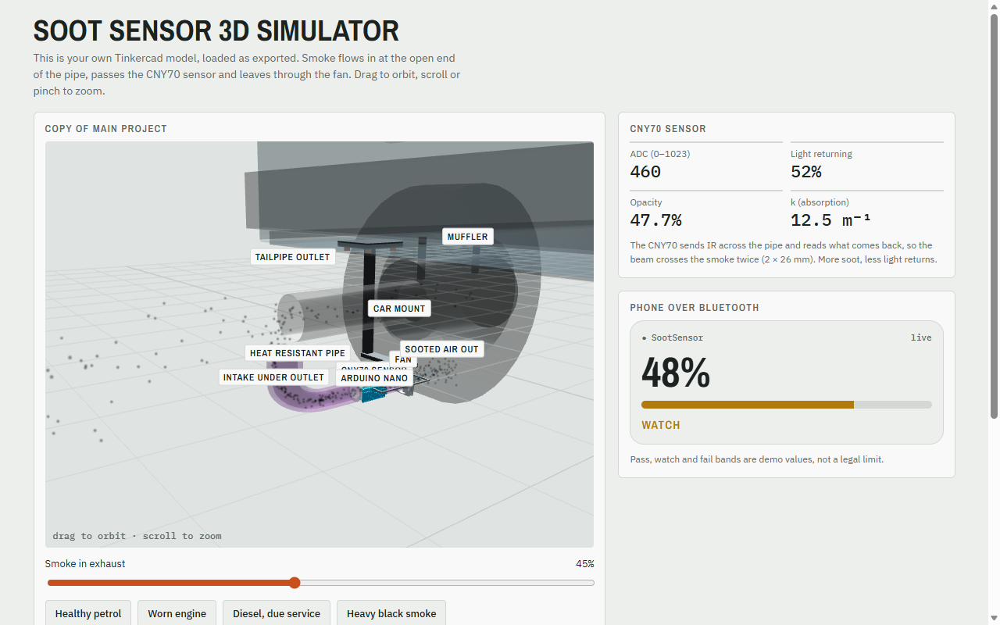
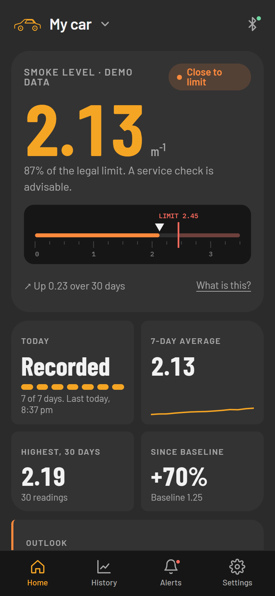
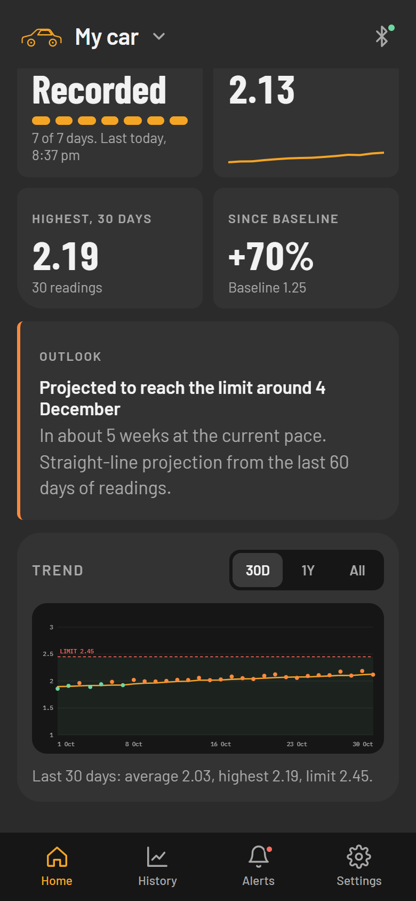
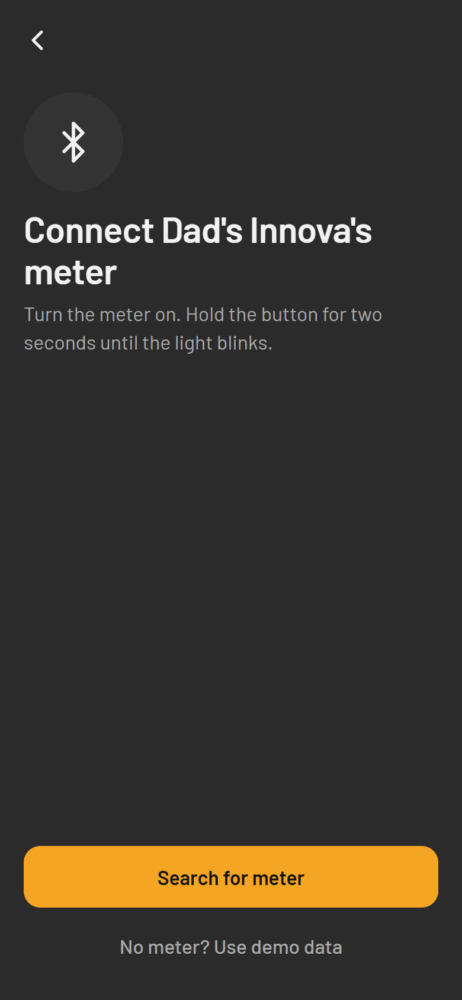
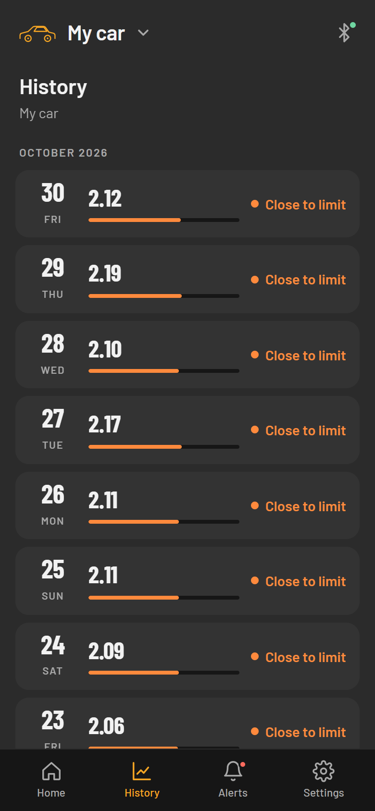

# SootAble

**A low-cost diesel exhaust meter and the phone app that reads it.** The meter clips under a vehicle's tailpipe and
measures the smoke in the exhaust once a day. The app collects those readings, tracks them over months, and warns the
owner while a worn injector or clogged filter is still a small repair.

C://hacks 2026 · App & Web Engineering (Advanced) · **UN SDG 13: Climate Action**

| | The meter (hardware) | The app (software) |
|---|---|---|
| What it is | A sensor unit with a fan, a heat-resistant pipe and a car mount, about Rs. 500 in parts | A phone app with a Python backend |
| What it does | Draws in exhaust, measures how much infrared light the smoke blocks, takes a clean-air reference | Turns readings into a smoke level, tracks the trend, forecasts, raises alerts |
| Status | Designed in CAD, shown as a 3D simulator | Working, with a virtual meter standing in for the real one |
| Try it | [Live 3D demo](https://ayushvyk.github.io/Maxwells-Silver-Hammer-C-HACKS/hardware/) | [Run the app](#run-the-app) |

<p>

</p>
<p>




</p>

## The problem

Diesel vehicles in India are checked for smoke at a Pollution Under Control (PUC) test once or twice a year. In between,
a worn injector or a clogged air filter can quietly push smoke up for months. That is wasted fuel, more black carbon (a
short-lived climate pollutant), and in the end a failed test and a bigger repair. Nobody sees the slow change because
nobody measures often enough, and engines degrade slowly, so a single reading says little; a long history says a lot.

## The meter

The meter is a short pipe fitted under the tailpipe outlet. A fan pulls exhaust through it. A CNY70 reflective infrared
sensor sits in the pipe: it sends light across and reads how much comes back, and the beam crosses the smoke twice (2 × 26
mm). More soot means less light returns. An Arduino Nano reads the sensor and an HM-10 Bluetooth module sends the result to the phone.

Each daily measurement is two steps: read the smoky air, then flush the pipe with clean air and read again as a
reference (`i0`). The phone computes the opacity coefficient, the quantity the legal limit is written in:

```
k = −(1 / L) · ln(i / i0)        limit: 2.45 m⁻¹ (65 Hartridge units)
```

`i` is the smoky reading, `i0` the clean-air reference and `L` the path length. Because `i0` is measured fresh every time,
slow drift in the LED and sensor cancels out.

**The meter has not been built.** It exists as a CAD model, so the [3D simulator](hardware/index.html) is how we show it:
drag to orbit, change the smoke in the exhaust, flush the pipe, and watch the sensor reading, opacity and k change, with
the phone's view and the Nano's serial output beside it. It runs offline too (the 3D library is bundled), either from the
live link above, by opening `hardware/index.html`, or at `/hardware/` when the app is running.

## The app

- **Home** shows today's smoke level on a ruler scale with the legal limit marked, four small tiles (today, 7-day average,
  highest, change since baseline), an outlook ("projected to reach the limit around ...") and a trend chart.
- **Readings arrive by themselves.** The meter records once a day. The app collects them when it opens, every few minutes
  while open, and on pull-down. Nobody takes a reading by hand.
- **Alerts** appear only when the status changes (good, close to limit, over limit). One odd reading never raises one.
- **Long memory, tiny footprint.** Up to 1000 days of readings (about 3 years) fit in roughly 130 KB of local storage.
- **Several vehicles, one meter each.** Each has its own readings, baseline, alerts and meter.
- **Private.** No account, no cloud. Everything is in a local SQLite database, with CSV export and delete-all.
- **Behaves like a phone app.** Installable on Android and iPhone, works offline, handles notches and the Android back
  gesture, and remembers where you were after a reload.

## How the two halves connect

The phone and the meter talk over Bluetooth using a small binary protocol (frames of `0xA5`, a type, a payload and a CRC-8
checksum, sent in 20-byte chunks). Bluetooth splits, merges and corrupts frames, so the phone buffers bytes, checks every
CRC, and tells the meter what it has saved so a reading is never lost.

Since the meter does not physically exist, `sootable/device_sim.py` is a virtual one that speaks exactly that protocol
through a simulated Bluetooth link. The app's parser, checksum and sync logic cannot tell it from hardware, so connecting
a real meter means replacing one transport class. **The readings in the demo are generated, not measured.**

```
meter (CNY70 + Nano + HM-10) ──bytes──▶ Bluetooth link ──20-byte chunks──▶ phone session (parse, CRC, sync)
   [virtual device today]                                                    │
              phone UI (HTML/JS) ◀── JSON ── FastAPI ◀── analytics ◀── SQLite (local)
```

## Run the app

The shortest route, on any computer: **Code → Download ZIP** at the top of this GitHub page, unzip it, then

- **Windows:** double-click `run.bat`.
- **macOS / Linux:** open a terminal in the unzipped folder and run `./run.sh`.

The first run sets up everything it needs (about a minute), then starts the app and opens it in your browser. Later runs
start at once. On Windows, `run.bat` even installs Python for you if the PC has none (it uses `winget`, which is built into
Windows 10 and 11). If it says to run it again after installing Python, just do.

<details>
<summary><b>Starting from a blank computer, or want to use git? Copy-paste steps for each system</b></summary>

Paste each block into a terminal (on Windows: PowerShell) and press Enter. You need Python 3.10 or newer and, only if you
want `git clone` instead of the ZIP, git.

**Windows 10 / 11.** Installs git and Python, then close the terminal and open a new one so they are found:

```
winget install -e --id Git.Git
winget install -e --id Python.Python.3.12
```

Then, in the new terminal:

```
git clone https://github.com/AyushVyk/Maxwells-Silver-Hammer-C-HACKS.git
cd Maxwells-Silver-Hammer-C-HACKS
.\run.bat
```

**macOS.** Git comes with Apple's command line tools (a window pops up, click Install and wait). Python 3.10+ is not
included: download the installer from [python.org/downloads](https://www.python.org/downloads/) and run it, or if you use
Homebrew, `brew install python`.

```
xcode-select --install
```

Then, in a new terminal:

```
git clone https://github.com/AyushVyk/Maxwells-Silver-Hammer-C-HACKS.git
cd Maxwells-Silver-Hammer-C-HACKS
./run.sh
```

**Linux (Debian / Ubuntu).**

```
sudo apt update
sudo apt install -y git python3 python3-venv python3-pip
git clone https://github.com/AyushVyk/Maxwells-Silver-Hammer-C-HACKS.git
cd Maxwells-Silver-Hammer-C-HACKS
./run.sh
```

**Doing the setup by hand** (what the launcher does for you): create a virtual environment, install the requirements, start.

```
python -m venv .venv
```

```
.venv/bin/python -m pip install -r requirements.txt
.venv/bin/python main.py
```

On Windows use `.venv\Scripts\python` in place of `.venv/bin/python`, and on macOS and Linux type `python3` instead of
`python` in the first command.

</details>

It lives at **http://127.0.0.1:8000** (it opens by itself). On a laptop it shows inside a phone-sized frame. The first run adds a vehicle and looks for
its meter; the search finds three virtual meters, and **No meter? Use demo data** loads months of example readings (a
healthy engine or one wearing out). To try it on a real phone on the same Wi-Fi, start it with `SOOTABLE_HOST=0.0.0.0`
(PowerShell: `$env:SOOTABLE_HOST = "0.0.0.0"`), open the address it prints, and use *Add to Home screen*.

Developer tools (hidden, not part of the product): open `/#dev`, or tap the version line in Settings five times. They run
test scenarios such as a 1000-day wear-out, bit errors or a dropped connection, and show the raw Bluetooth bytes.

## Tech and structure

Python 3, FastAPI, SQLite; plain HTML, CSS and JavaScript for the UI (no framework, no build step; charts are inline SVG);
three.js for the 3D demo. The maths and alert rules are pure functions with no I/O, so they can move into a native app.

| Path | What it is |
|---|---|
| `hardware/` | The 3D meter simulator (also served by GitHub Pages) |
| `sootable/` | Backend: protocol (`crc8.py`, `frame.py`), maths and rules (`k.py`, `daily.py`, `alerts.py`), storage (`store.py`), sync (`session.py`), virtual meter (`device_sim.py`, `link.py`, `scenarios.py`), analytics (`engine.py`), API (`server.py`) |
| `web/` | The phone UI: `index.html`, `style.css`, `app.js`, service worker, fonts, icons |
| `tests/` | 94 automated tests (`pip install -r requirements-dev.txt`, then `python -m pytest`) |
| `docs/` | [PROJECT.md](docs/PROJECT.md) (problem, design decisions, limits) and [LAUNCH.md](docs/LAUNCH.md) (route to the App Store and Google Play) |
| `run.bat`, `run.sh`, `main.py`, `requirements*.txt` | One-click launchers, the start script and the Python dependencies |


## What is next

Build the meter and run it over real Bluetooth, then calibrate against a reference opacimeter (an infrared LED does not
match the green light of the legal test method). After that: limits per vehicle category and emission norm, a native
Android and iOS app (route in [docs/LAUNCH.md](docs/LAUNCH.md)), a service report to share with a mechanic, and regional
languages.

## Limits

This is a prototype. No real reading has been taken. Alert thresholds are placeholders until there is real data, and the
2.45 m⁻¹ limit is for one vehicle class. SootAble does not replace a PUC certificate, and works on diesel exhaust only.

## Credits and AI-usage disclosure

Generative AI was used: we used Claude (Anthropic) through Claude Code to help plan
the project and write the code, tests and documentation with human-in-the-loop to verify. The product idea, the specification, the CAD design, the choice
of SDG and the design direction are the team's.

Open-source software: FastAPI, Uvicorn, SQLite, three.js, pytest, HTTPX. Fonts, bundled for offline use: Barlow, Barlow
Condensed and IBM Plex Mono (SIL Open Font License), Clash Display (Fontshare Free Font License).
