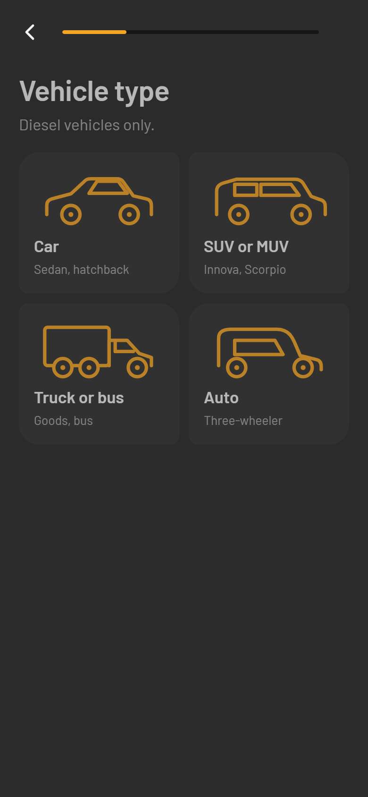
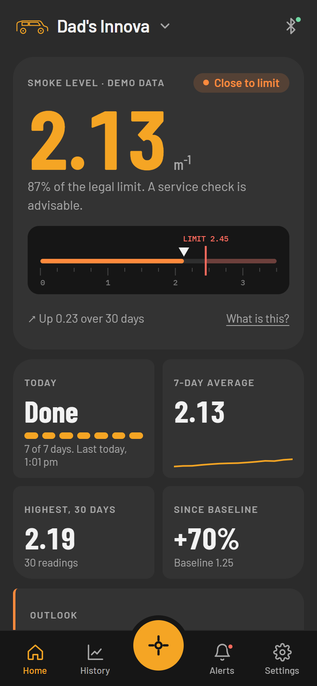
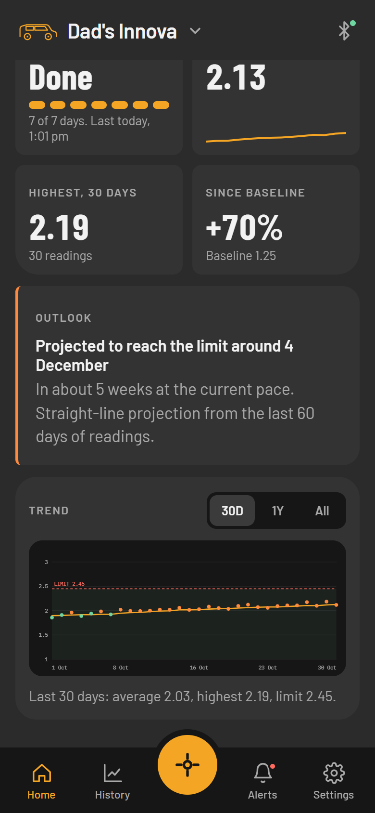

# SootAble

**A daily smoke reading for your diesel engine, taken automatically.** SootAble is a phone app for a low-cost (about Rs. 500) diesel exhaust
opacity meter. The meter measures how much infrared light the exhaust absorbs; the app turns that into the smoke level the
law uses, tracks it day by day, and warns the owner while a worn injector or clogged filter is still a small problem,
months before the next PUC test.

C://hacks 2026 · App & Web Engineering · Advanced · **UN SDG 13: Climate Action**

<p>




</p>

## Run it

Needs Python 3.10 or newer.

```
python -m venv .venv
.venv\Scripts\activate            # macOS / Linux: source .venv/bin/activate
pip install -r requirements.txt
python main.py
```

Open **http://127.0.0.1:8000**. It is a phone app, so it shows inside a phone frame on a laptop.
To try it on a real phone on the same Wi-Fi, start it with `SOOTABLE_HOST=0.0.0.0` (PowerShell:
`$env:SOOTABLE_HOST = "0.0.0.0"`); it prints the address to open, and *Add to Home screen* installs it on Android and
iPhone. How it would become a store app is in [docs/LAUNCH.md](docs/LAUNCH.md).

**Built with:** Python 3, FastAPI, Uvicorn and SQLite for the logic and storage; plain HTML, CSS and JavaScript for the
phone UI (no framework, no build step).

## A two-minute tour

1. **First run.** Vehicle type and name, then **find and connect the vehicle's meter**: the app searches, lists
   the meters in range, and connects to the one you pick. A vehicle needs its own meter before a reading can be taken, and
   there is no account. Because no physical meter exists yet, the search finds three demo meters; **No meter? Use demo
   data** loads months of example readings instead.
2. **Home.** The smoke level against the legal limit (2.45 m⁻¹) on a ruler scale, four metric tiles (today, 7-day average,
   highest, change since baseline), an **Outlook** (when the limit would be reached at the current pace), and a trend chart
   you can touch (30D / 1Y / All) with the within-limit range shaded.
3. **Readings arrive by themselves.** The meter records one reading a day on its own; the app collects them when it opens, every few minutes while open, and on pull-down. Nobody takes a reading by hand.
4. **Several vehicles, one meter each.** Tap the vehicle name at the top to add another. Adding a vehicle goes straight to
   connecting its meter, with the same two choices as the first car: **search over Bluetooth** (the list shows every meter in
   range and which car it is on; connecting one that is on another car moves it, after syncing what it had stored for that
   car) or **use demo data** (loads example readings for just that car and leaves the others alone). A vehicle without a
   meter says so and cannot take readings.
5. **History, Alerts, Settings.** Alerts only appear when the status changes. Settings shows the vehicle's meter (firmware
   and sampling chamber, read from the meter's own handshake) and can change or forget it.

**Developer tools (not part of the product).** Open `/#dev`, or tap the version line in Settings five times. They run the
test scenarios (a 1000-day wear-out, bit errors on the link, a dropped connection, a meter reboot) and show the raw
Bluetooth bytes as they are decoded.

## About the hardware

The meter exists as a CAD design and has not been built. To show the whole data path anyway, `sootable/device_sim.py` is
a **virtual device**: it behaves like the Arduino Nano + HM-10 firmware and talks to the app only through the real byte
frames of the protocol (sync byte, CRC-8, 20-byte Bluetooth chunks). The app's parser, CRC check and sync logic cannot
tell it from hardware; connecting a real meter means replacing one transport class. The pairing screens (scan, choose,
connect, handshake) run against it exactly as they would against a real meter's advertisement. **The readings in the demo
are generated, not measured, and the meters found when searching are virtual ones.**

**Hardware demo.** A 3D simulator built from the team's own CAD model of the meter: drag to orbit, change the smoke in the
exhaust, and watch the infrared sensor reading, opacity and k change, with the phone's view and the ESP32 serial log
beside it. Start the app and open **http://127.0.0.1:8000/hardware** (or the Developer section in Settings). The file is
[hardware/index.html](hardware/index.html); its 3D library is bundled, so it works offline.

```
virtual device ──bytes──▶ simulated Bluetooth link ──20-byte chunks──▶ phone session (parse, CRC, sync)
                                                                              │
              phone UI (HTML/JS) ◀── JSON ── FastAPI ◀── analytics ◀── SQLite (local)
```

## What is in this repo

| Path | What it is |
|---|---|
| `main.py` | Starts the app |
| `sootable/` | The app: protocol (`crc8.py`, `frame.py`), maths and rules (`k.py`, `daily.py`, `alerts.py`), storage (`store.py`), sync (`session.py`), simulator (`device_sim.py`, `link.py`, `scenarios.py`), analytics (`engine.py`), API (`server.py`) |
| `web/` | The phone UI: `index.html`, `style.css`, `app.js`, service worker, fonts, logo and icons, manifest |
| `hardware/` | The 3D simulator of the meter's CAD model (served at `/hardware`) |
| `tests/` | 94 automated tests |
| `docs/PROJECT.md` | Problem, solution, features, tech, challenges, future improvements |
| `docs/LAUNCH.md` | How it runs on iOS and Android today and the route to the App Store and Google Play |
| `docs/screenshots/` | Screens of the app |

## Tests

```
pip install -r requirements-dev.txt
python -m pytest
```

They cover the byte-exact protocol examples, frame parsing under splits, merges and every single-bit corruption, the
maths and the legal-limit boundary, the alert rules, every simulator scenario, storage limits, multiple vehicles and a
database upgrade, pairing (scan, connect, move, forget, one meter per vehicle, and no readings without a meter), and the
HTTP API.

## Credits and AI-usage disclosure

Generative AI was used, as the rules require us to disclose. We used **Claude (Anthropic) through Claude Code** to help
plan the project, write the code, tests and documentation, and review the design against our build specification. The
product idea, the specification, the choice of SDG and the design direction are the team's.

Open-source software: FastAPI, Uvicorn, Pydantic, SQLite, pytest, HTTPX. Fonts (SIL Open Font License, bundled for offline
use): Barlow, Barlow Condensed, IBM Plex Mono. The legal limit (2.45 m⁻¹, 65 Hartridge units) is the CMVR limit named in
our specification.

SootAble does not replace a PUC certificate or an OBD scanner, and works on diesel exhaust only.
